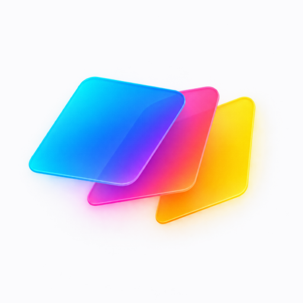
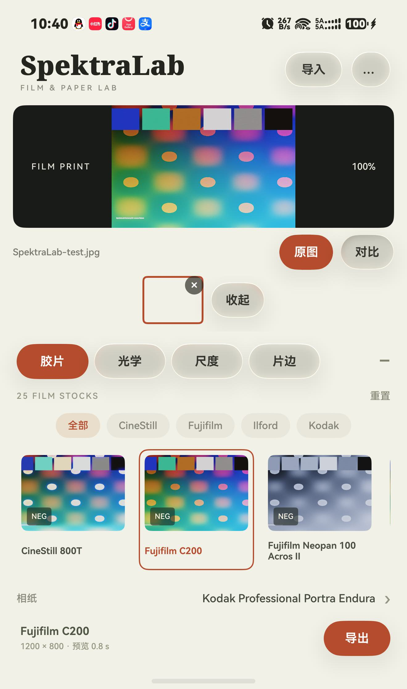
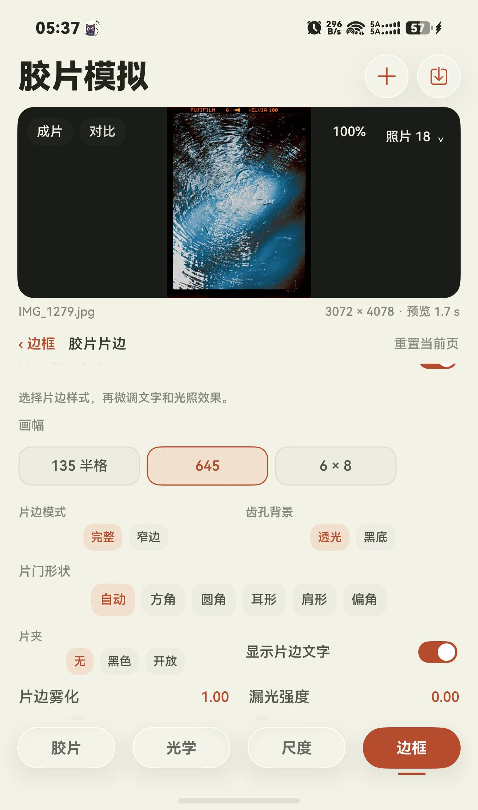

  

<h1 align="center">Harmony-SpektraLab</h1>

  <strong>SpektraLab · HarmonyOS</strong> 
  在鸿蒙设备上，探索胶片、相纸与光的层次。

  <a href="https://github.com/abc123-hubish/Harmony-SpektraLab/releases">版本下载</a> ·
  <a href="#功能亮点">功能亮点</a> ·
  <a href="#应用预览">应用预览</a> ·
  <a href="#使用说明">使用说明</a> ·
  <a href="https://github.com/abc123-hubish/Harmony-SpektraLab/issues">问题反馈</a>

SpektraLab 是一款胶片与相纸模拟工具。本项目基于 [SpektraLab](https://github.com/JamesQiu2005/SpektraLab) 及其 [Android 移植](https://github.com/SAINTTaiYi/SpektraLab-Android)，将光谱成像引擎与 HarmonyOS 原生界面结合，让你从选择胶片、搭配相纸，到调节颗粒、光晕和片边，在手机上完成一次数字暗房创作。

本仓库用于展示 HarmonyOS 版本、维护使用说明和接收问题反馈，并预留安装包发布入口。目前仅包含项目文档和展示图片，尚未上传应用源码或发布安装包。

## 功能亮点

- **25 款胶片**：涵盖 Kodak、Fujifilm、Ilford 与 CineStill，包含彩色负片、电影负片、黑白负片和反转片；按品牌筛选，使用当前照片预览胶片效果。
- **9 款相纸与拷贝片**：组合胶片与相纸的影调，支持手动选择，或开启推荐相纸匹配。反转片采用直接扫描成像。
- **光学与暗房调节**：调整放大机曝光、颗粒、光晕、眩光，以及高光与暗部保护、镜头柔化、滤色和预闪等参数。
- **画幅与物理尺度**：提供多种胶片尺度与片边载体，探索不同颗粒观感、画幅和胶片呈现方式。
- **胶片片边与日期后背**：可设置齿孔、片夹、片边文字、雾化、漏光和帧号，并为画面或片边添加日期与拍摄数据。
- **负像与橙罩**：负片可切换负像显示；片边另有独立的负片橙罩选项。反转片直接显示正像。
- **照片导入与对比**：通过系统相册或文件选择器导入照片，提供 RAW 解码、照片切换、原图对比和缩放查看。
- **JPEG 与 16 位 TIFF 导出**：按用途选择实时画质、预览画质或当前导入尺寸，支持保存与分享。
- **鸿蒙原生体验**：采用 ArkUI 界面与 Vulkan 渲染，围绕胶片、光学、尺度和边框组织编辑流程，融入系统沉浸光感。

查看胶片与相纸目录

### 胶片 · 25 款

| 类型 | 胶片 |
| --- | --- |
| 彩色负片 | Kodak Portra 160 / 400 / 800、Portra 800 Push 1 / Push 2、Ektar 100、Gold 200、Ultramax 400；Fujifilm C200、Pro 400H、X-Tra 400 |
| 电影负片与 CineStill | Kodak Vision3 50D / 200T / 250D / 500T、Verita 200D；CineStill 800T |
| 黑白负片 | Kodak Tri-X 400、T-Max 100；Ilford HP5 Plus 400；Fujifilm Neopan 100 Acros II |
| 反转片 | Fujifilm Provia 100F、Velvia 100；Kodak Ektachrome 100、Kodachrome 64 |

### 相纸与拷贝片 · 9 款

| 类型 | 相纸 / 拷贝片 |
| --- | --- |
| 彩色相纸 | Fujifilm Crystal Archive Type II；Kodak Ektacolor Edge、Endura Premier、Portra Endura、Supra Endura、Ultra Endura |
| 黑白相纸 | Ilford Multigrade IV RC |
| 电影拷贝片 | Kodak Vision 2383、Vision Premier 2393 |

胶片、相纸名称用于标识模拟对象，相关商标归各自权利人所有。

## 应用预览

以下为 HarmonyOS 适配开发期间保存的运行截图，展示胶片预览与片边编辑。部分截图保留了早期界面或“胶片模拟”名称，实际界面以安装版本为准；点击图片可查看原图。

<table>
  <tr>
    <th width="50%">胶片选择与成像预览</th>
    <th width="50%">胶片片边与画幅设置</th>
  </tr>
  <tr>
    <td align="center"></td>
    <td align="center"></td>
  </tr>
</table>

## 下载与安装

安装包和版本说明将发布在 [Releases](https://github.com/abc123-hubish/Harmony-SpektraLab/releases)。**当前尚无公开 Release，暂未提供可下载安装包。**

| 项目 | 说明 |
| --- | --- |
| 系统要求 | 当前工程最低要求 HarmonyOS 6.1.1（API 24） |
| 设备架构 | ARM64；需要兼容的 Vulkan GPU 与驱动 |
| 设备适配 | 已进行手机真机测试；平板与二合一设备仍待专项验证 |
| 应用包名 | `com.bogdan.SpektraLab` |
| 安装格式 | 发布后以对应 Release 的 HAP 附件和安装说明为准 |
| 仓库内容 | 项目介绍、使用说明、应用图标与预览截图 |

后续版本发布后，请从 Release 的 Assets 区域下载安装包，并阅读对应版本说明。GitHub 自动生成的 **Source code (zip / tar.gz)** 只会打包本仓库文件，不是可直接安装的应用。

## 使用说明

1. **导入照片**：点击导入入口，从系统相册选择图片；RAW 等文件可通过文件选择器导入。
2. **选择胶片**：在“胶片”页按品牌浏览，选择喜欢的胶片；负片可继续搭配相纸或拷贝片，推荐匹配默认关闭，可按需开启。
3. **调节成像**：进入“光学”页调整曝光、颗粒、光晕与眩光；在高级设置中细调滤色、保护和扫描参数。
4. **设定尺度与边框**：在“尺度”页选择物理尺度；在“边框”页添加胶片片边或日期后背，并调整样式。
5. **检查效果**：切换原图与成片，使用对比、缩放查看细节；导入多张照片时可在照片架中切换。
6. **导出作品**：选择 JPEG 或 TIFF，以及适合用途的画质档位，完成系统保存或分享流程。

### 导出怎么选？

| 选项 | 适合用途 | 说明 |
| --- | --- | --- |
| JPEG | 日常保存与分享 | 8 位 sRGB；全尺寸档使用 4:4:4 色度采样 |
| TIFF | 后续调色与精修 | 16 位 RGB，嵌入 sRGB ICC；文件通常更大 |
| 实时画质 | 快速试片 | 长边目标 2048 像素 |
| 预览画质 | 较高分辨率预览 | 长边目标 3400 像素 |
| 全尺寸 | 保留当前导入分辨率 | 按当前导入尺寸渲染，添加片边后画布尺寸可能增大 |

“全尺寸”指当前导入尺寸。如果导入时已缩小图片，该档位不会恢复原文件分辨率。编辑预览与导出分开处理，屏幕预览分辨率不等于最终导出分辨率。

## 兼容性与当前边界

- **RAW 支持因相机而异**：使用 LibRaw 解码；不同相机型号、压缩方式和 DNG 变体的兼容性需要逐一验证。DNG 可用于导入，当前导出菜单提供 JPEG 与 TIFF。
- **高像素处理需要时间与内存**：大尺寸 RAW、颗粒、光晕和片边组合会增加计算量，实际表现取决于照片、GPU 与系统可用内存。
- **反转片有独立的成像方式**：Provia、Velvia、Ektachrome、Kodachrome 直接扫描成像，相纸和部分相纸专用调节不参与这一流程。
- **设备验证仍在继续**：已有手机上的运行与导出验证，不代表所有设备、RAW 格式、系统图库或外部编辑器均已完成验收。

## 问题反馈

欢迎在 [Issues](https://github.com/abc123-hubish/Harmony-SpektraLab/issues) 提交问题或建议。为便于复现，请尽量附上：

- 应用版本、设备型号与 HarmonyOS 版本。
- 操作步骤、预期效果和实际结果。
- 导入文件格式与分辨率；RAW 问题请补充相机型号。
- 使用的胶片、相纸和关键参数；导出问题请注明格式与画质档位。
- 必要的截图或错误提示。上传前请检查照片、文件名和截图中的个人信息。

## 致谢与许可证

感谢以下项目及其贡献者，让胶片光谱模拟能够来到鸿蒙设备：

| 项目 / 作者 | 用途与许可 |
| --- | --- |
| [JamesQiu2005 / SpektraLab](https://github.com/JamesQiu2005/SpektraLab) | 胶片与相纸模拟引擎；GPL-3.0-or-later |
| [SAINTTaiYi / SpektraLab-Android](https://github.com/SAINTTaiYi/SpektraLab-Android) | Android 移植与平台适配参考；GPL-3.0-or-later |
| [Andrea Volpato / spektrafilm](https://github.com/andreavolpato/spektrafilm) | 原始胶片配置及相关数据；相关配置与衍生数据使用 CC BY-SA 4.0 |
| LibRaw | RAW 解码；LGPL-2.1 |
| libjpeg-turbo | JPEG 编解码；IJG / BSD / zlib |
| Little CMS | 色彩管理；MIT |
| Liberation Sans / DejaVu | 字体，遵循各自随附许可 |
| @tangs/components | 鸿蒙沉浸光感组件，遵循随附许可 |

HarmonyOS 适配由 Bogdan 维护，本项目为非官方移植，与上游项目及胶片品牌不存在官方隶属关系。应用代码沿用 GPL-3.0-or-later，第三方数据与组件保留各自的署名和许可；完整许可原文随应用资源保留。本仓库目前的展示用途不改变应用及上游组件的许可。
